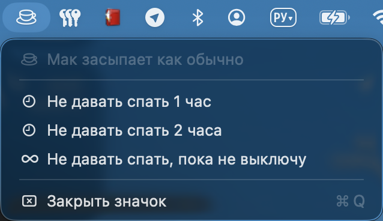
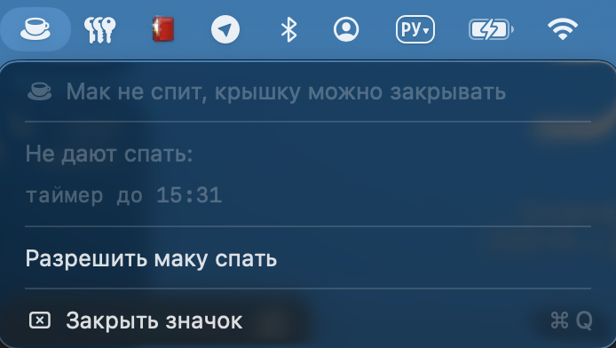

# nosleep

**Русский** | [English](README.en.md)

Мак не засыпает при закрытой крышке, пока идёт команда (например, сессия claude
или долгая сборка). Плюс значок в панели меню: видно, спит мак или нет, и можно
включить/выключить одним кликом.

Основа - `pmset -a disablesleep 1`. `caffeinate` тут не помогает: при закрытой
крышке мак всё равно засыпает.

<p>
  
  
</p>

## Команды

```
nosleep claude          # флаг держится, пока идёт claude
nosleep for 1h          # не спать час (90m, 30 - минуты)
nosleep on | off        # ручной режим
nosleep off --force     # снять всё
nosleep status
```

Несколько `nosleep <команда>` одновременно - нормально: мак уснёт, когда
закончится последняя.

## Установка

Нужно: macOS 13+, Xcode Command Line Tools (`xcode-select --install`, для `swiftc`).

```
git clone https://github.com/altairdeark/nosleep.git
cd nosleep
./install.sh             # спросит пароль администратора один раз
./install.sh uninstall   # убрать всё и вернуть обычный сон
```

Что ставит:
- `/etc/sudoers.d/nosleep` - без пароля разрешены только `pmset -a disablesleep 0|1`
  (шаблон: `install/sudoers-nosleep`). Скрипт проверяет, что остальной sudo
  по-прежнему просит пароль.
- `~/.local/bin/nosleep` - симлинк на `bin/nosleep`. `~/.local/bin` должен быть в `PATH`.
- значок `~/Applications/NosleepBar.app` (собирается из `menubar/NosleepBar.swift`
  через `swiftc`) и его автозапуск `~/Library/LaunchAgents/local.nosleep.bar.plist`.

Папку с репой после установки не удалять и не переносить: команда - симлинк на неё.

## Панель меню

- пустая чашка - обычный сон
- полная чашка - сон отключён
- оранжевая полная чашка - сон отключён, но сессий нет (краш, перезагрузка) или мак
  на батарее (работает, но разряжается и греется)

В меню: что сейчас не даёт спать, "Не давать спать 1 час / 2 часа / пока не выключу",
"Разрешить маку спать".

Язык (меню, команда, установщик): русский, если регион Россия или система на русском, иначе английский.

## Осторожно

- Мак с закрытой крышкой в сумке греется. На батарее значок становится оранжевым.
- Если процесс убит через `kill -9` или мак упал, флаг остаётся включённым (и
  переживает перезагрузку). Значок это покажет оранжевым, снять - `nosleep off --force`
  или пункт в меню.

## Лицензия

MIT
